  

  <a href="#about">About</a> &nbsp;·&nbsp;
  <a href="#engineering-focus">Expertise</a> &nbsp;·&nbsp;
  <a href="#selected-work">Projects</a> &nbsp;·&nbsp;
  <a href="#tech-stack">Stack</a> &nbsp;·&nbsp;
  <a href="#github-activity">Activity</a> &nbsp;·&nbsp;
  <a href="#connect">Connect</a>

  <strong>Understand the system. Build it better.</strong>

## About

I'm a software engineer focused on **low-level systems, game technologies, and automation**. I build efficient, maintainable software with particular attention to performance, resource usage, and how systems behave beneath the surface.

My main languages are **C++, C#, and Python**. I use reverse engineering and low-level analysis to understand existing implementations, investigate problems, and develop practical improvements.

Much of my work centers on **game systems and the tools around them**: client and server development, engine behavior, performance optimization, and workflows that make complex projects easier to maintain.

## Engineering Focus

| Area | What I focus on |
| :--- | :--- |
| **Game Systems & Engines** | Gameplay systems, engine development, and client–server integration. |
| **Reverse Engineering** | Understanding program behavior, tracing execution, and analyzing existing implementations. |
| **Performance Optimization** | Finding bottlenecks, reducing unnecessary work, and improving resource efficiency. |
| **Automation & Tooling** | Developer utilities and repeatable workflows that simplify everyday engineering tasks. |

## Selected Work

| Project | Focus |
| :--- | :--- |
| **[Anka2 Project](https://github.com/ybeststudio/Anka2Project)** | Metin2 server and client development, custom game systems, and integration work. |
| **[M2 Sentinel Core](https://github.com/ybeststudio/M2-Sentinel-Core)** | Rule-based source analysis with parallel scanning and JSON, TXT, and SARIF reports. |
| **[Metin2 Web Client](https://github.com/ybeststudio/Metin2-Web-Client)** | A browser-based 3D client built with Three.js and React Three Fiber. |

  <a href="https://github.com/ybeststudio?tab=repositories"><strong>Explore all repositories →</strong></a>

## Tech Stack

**Primary languages**

  
  
  

**Scripting & databases**

  
  
  

## Engineering Approach

- **Understand before changing.** Trace behavior and dependencies before choosing an implementation.
- **Measure performance.** Use profiling and reproducible workloads to guide optimization.
- **Fix root causes.** Make failures observable and investigate why they happen.
- **Build for maintenance.** Keep components clear, changes focused, and repeated work automated.

## GitHub Activity

  <a href="https://github.com/ybeststudio?tab=repositories">Public repositories</a> &nbsp;·&nbsp;
  <a href="https://github.com/ybeststudio?tab=overview">Contribution history</a>

  
<strong>View GitHub statistics</strong>

 

  

  

  

  Language statistics reflect repository code, not proficiency.

## Connect

For questions about my projects, technical discussions, or collaboration:

  
  
  
  
  

---

  <strong>Best Studio</strong> &nbsp;·&nbsp; <a href="https://github.com/ybeststudio">@ybeststudio</a> 
  Game systems · Low-level engineering · Automation

